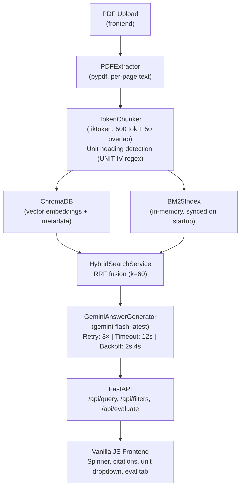

# MRSPTU StudyRAG 🎓

> **Grounded Study Assistant for MRSPTU Syllabi using Hybrid RAG (Vector + BM25 + RRF + Gemini)**

A FastAPI-based Retrieval-Augmented Generation (RAG) system that lets students ask questions against uploaded MRSPTU syllabus PDFs and study notes. Answers are strictly grounded in retrieved passages with page-level citations, backed by Google Gemini for natural language generation.

---

## Overview

- **Hybrid Search**: ChromaDB vector similarity + BM25 keyword search fused with Reciprocal Rank Fusion (RRF)
- **Unit-Aware Chunking**: Detects `UNIT-I`, `UNIT-II`, `UNIT-IV (11 Hrs)` headings automatically; carries unit context forward across pages
- **Guardrailed LLM**: Off-topic questions (e.g. "Who won IPL?") return a fixed Urdu/Hindi not-found message, never hallucinated content
- **LLM Resilience**: Auto-retries Gemini on 503/429 with backoff; falls back to raw passages after 3 failed attempts
- **Viva Benchmark**: `/api/evaluate` endpoint measures Hit Rate@K (Vector vs Hybrid) without ever calling Gemini

---

## Architecture



---

## Tech Stack

| Layer | Technology |
|---|---|
| Backend | FastAPI, Python 3.13, uvicorn |
| Vector Store | ChromaDB (persistent, local) |
| Keyword Search | rank-bm25 (BM25Okapi) |
| Fusion | Reciprocal Rank Fusion (RRF, k=60) |
| PDF Parsing | pypdf |
| Tokenization | tiktoken (cl100k_base) |
| LLM | Google Gemini (`gemini-flash-latest`) |
| Frontend | Vanilla JS, HTML5, CSS3 |

---

## Setup & Run (Windows PowerShell)

### 1. Clone & enter the directory
```powershell
git clone <repo-url>
cd "7th sem projext"
```

### 2. Create and activate a virtual environment
```powershell
python -m venv venv
.\venv\Scripts\Activate.ps1
```

### 3. Install dependencies
```powershell
pip install -r requirements.txt
```

### 4. Add your `.env` file
Create `backend/.env` (or project root `.env`) with:
```
GEMINI_API_KEY=your_key_here
```
> **Never commit `.env` to version control.**

### 5. Run the server
```powershell
uvicorn backend.app.main:app --reload
```
The app is now live at **http://localhost:8000**

> On startup, the server automatically syncs the BM25 index with all chunks in ChromaDB.

### 6. Upload PDFs
- Open http://localhost:8000 in your browser
- Use the **Upload** tab to ingest syllabus PDFs
- Subject name and unit are auto-detected from PDF headings

---

## API Endpoints

| Method | Path | Description |
|---|---|---|
| `GET` | `/api/health` | Health check + chunk count |
| `GET` | `/api/filters` | Subjects & units for UI dropdowns |
| `POST` | `/api/ingest` | Upload and index a PDF |
| `POST` | `/api/query` | Ask a question (hybrid RAG) |
| `POST` | `/api/evaluate` | Retrieval benchmark (no LLM) |
| `DELETE` | `/api/documents/{doc_id}` | Remove a document |

---

## Evaluation Results

**Benchmark: 20 questions verified against real page content in ChromaDB**
- Sources: HCI Notes (15 pages), CSE Sem 7 Syllabus (16 pages)
- Retrieval only — **Gemini was NOT called** during evaluation
- Evaluated via `/api/evaluate` endpoint

| K (top-K chunks) | Vector Hit Rate | Hybrid RRF Hit Rate | Delta |
|:---:|:---:|:---:|:---:|
| **1** | 75.0% (15/20) | **80.0% (16/20)** | **+5.0%** |
| **2** | 85.0% (17/20) | **90.0% (18/20)** | **+5.0%** |
| **3** | **95.0% (19/20)** | 90.0% (18/20) | -5.0% |

> Hybrid RRF outperforms pure vector search at K=1 and K=2 (the practically important range). At K=3, vector slightly edges ahead due to BM25 picking up a semantically different match for Q7 (Nielsen heuristics → page 12 returned instead of page 10).

---

## Guardrail Verification

```
Query: "Who won the IPL?"
Answer: "Yeh answer uploaded material mein nahi mila"
is_fallback: True
```

Off-topic queries that have no relevant retrieved passages are blocked by a similarity threshold check and return the fixed not-found message — no hallucination.

---

## Project Structure

```
7th sem projext/
├── backend/
│   └── app/
│       ├── main.py          # FastAPI app, all endpoints, timing logs
│       ├── models.py        # Pydantic models (Chunk, Citation, QueryRequest, ...)
│       ├── config.py        # Settings from .env
│       └── rag/
│           ├── pdf_extractor.py   # pypdf page-by-page extraction
│           ├── chunker.py         # TokenChunker + unit heading detection
│           ├── vector_store.py    # ChromaDB wrapper
│           ├── bm25_search.py     # BM25Okapi index + search
│           ├── hybrid_search.py   # RRF fusion of vector + BM25
│           └── llm.py             # Gemini answer generation, retry + fallback
├── frontend/
│   ├── index.html           # Main UI
│   └── app.js               # Query handler, spinner, citations, eval tab
├── uploads/                 # Saved copies of uploaded PDFs
├── chroma_db/               # Persistent ChromaDB storage
├── .env                     # API keys (not committed)
├── requirements.txt
└── README.md
```

---

## Changed Files Summary

| File | Change |
|---|---|
| `backend/app/models.py` | `unit: Optional[int] = None` in ChunkMetadata; `unit: Optional[str]` in Citation |
| `backend/app/rag/vector_store.py` | Unit None handling; `get_distinct_subjects_and_units()` returns `List[str]` labels |
| `backend/app/rag/chunker.py` | Full rewrite: `_UNIT_RE` regex, Roman numeral conversion, unit carry-forward across pages |
| `backend/app/rag/bm25_search.py` | Unit filter: regex digit extraction instead of `.strip()` |
| `backend/app/rag/llm.py` | 3-attempt retry with backoff, 12s timeout, passage fallback, separated timing |
| `backend/app/main.py` | Retrieval + Gemini timing logs, graceful exception fallback passage text |
| `frontend/app.js` | Client-side latency, spinner fix, clean citation labels, 20-query benchmark |
| `frontend/index.html` | Replaced OS-topic chips with 4 real topics from ingested PDFs |

