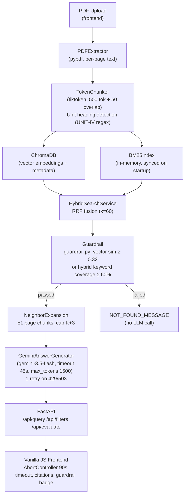

# Arise.ai 🎓

> **Grounded Study Assistant for MRSPTU Syllabi using Hybrid RAG (Vector + BM25 + RRF + Gemini)**

A FastAPI-based Retrieval-Augmented Generation (RAG) system that lets students ask questions against uploaded MRSPTU syllabus PDFs and study notes. Answers are strictly grounded in retrieved passages with page-level citations, backed by Google Gemini for natural language generation.

---

## Overview

- **Hybrid Search**: ChromaDB vector similarity + BM25 keyword search fused with Reciprocal Rank Fusion (RRF, k=60)
- **Unit-Aware Chunking**: Detects `UNIT-I`, `UNIT-II`, `UNIT-IV (11 Hrs)` headings automatically; carries unit context forward across pages
- **Confidence Guardrail**: Off-topic questions (e.g. "Who won IPL?") are blocked before reaching the LLM — never hallucinated content
- **LLM Resilience**: 45-second HTTP timeout, 1 retry on 429/503, graceful fallback to raw passages; never crashes the server
- **Neighbor-Chunk Expansion**: After retrieval, ±1 page chunks are added to LLM context (deduplicated, capped at K+3), improving multi-page answer coverage
- **Viva Benchmark**: `/api/evaluate` measures Hit Rate@K (Vector vs Hybrid) without calling Gemini
- **Deploy-Ready**: Single-worker `uvicorn` (BM25 is in-process), Dockerfile with pre-cached ONNX embedding model, `$PORT`-aware CMD

---

## Architecture



---

## Tech Stack

| Layer | Technology |
|---|---|
| Backend | FastAPI 0.159, Python 3.11, uvicorn 0.54 |
| Vector Store | ChromaDB 1.5.9 (persistent, local) |
| Keyword Search | rank-bm25 0.2.2 (BM25Okapi) |
| Fusion | Reciprocal Rank Fusion (RRF, k=60) |
| PDF Parsing | pypdf 6.21.2 |
| Tokenization | tiktoken 0.14.0 (cl100k_base) |
| LLM | Google Gemini `gemini-3.5-flash` (via google-genai 2.32.0) |
| Frontend | Vanilla JS, HTML5, CSS3 |
| Deployment | Docker (python:3.11-slim), $PORT-aware |

---

## Setup & Run (Windows PowerShell)

### 1. Clone & enter the directory
```powershell
git clone <repo-url>
cd "7th sem projext"
```

### 2. Create and activate a virtual environment
```powershell
python -m venv venv
.\venv\Scripts\Activate.ps1
```

### 3. Install dependencies
```powershell
pip install -r requirements.txt
```

### 4. Configure environment
Copy `.env.example` to `.env` and fill in your Gemini API key:
```powershell
Copy-Item .env.example .env
# Edit .env and set GEMINI_API_KEY=your_key_here
```
> **Never commit `.env` to version control.** The `.gitignore` excludes it.

### 5. Run the server
```powershell
uvicorn backend.app.main:app --reload
```
The app is now live at **http://localhost:8000**

> On startup, the server automatically syncs the BM25 index with all chunks in ChromaDB (~36 chunks).

### 6. Upload PDFs
- Open http://localhost:8000 in your browser
- Use the **Upload** tab to ingest syllabus PDFs
- Subject name is entered manually; unit number is auto-detected from PDF headings

---

## Docker Deployment

```bash
# Build (pre-caches the ONNX embedding model in the image)
docker build -t arise-rag .

# Run (PORT defaults to 8000)
docker run -p 8000:8000 -e GEMINI_API_KEY=your_key arise-rag

# Custom port
docker run -p 3000:3000 -e PORT=3000 -e GEMINI_API_KEY=your_key arise-rag
```

> The `chroma_db/` directory is bundled in the image with the 3 cleaned documents (36 chunks). No re-ingestion needed.

**Optional security env vars (all off by default):**

| Variable | Effect |
|---|---|
| `ADMIN_TOKEN` | Requires `X-Admin-Token` header on ingest / delete endpoints |
| `RATE_LIMIT_PER_HOUR` | Per-IP query rate limit (in-memory, resets on restart) |
| `ALLOWED_ORIGINS` | Comma-separated CORS origins; default `*` |
| `MAX_UPLOAD_MB` | Max PDF upload size (default 25) |

---

## API Endpoints

| Method | Path | Description |
|---|---|---|
| `GET` | `/api/health` | Health check + chunk count |
| `GET` | `/api/filters` | Subjects & units for UI dropdowns |
| `POST` | `/api/ingest` | Upload and index a PDF |
| `POST` | `/api/query` | Ask a question (hybrid RAG) |
| `POST` | `/api/evaluate` | Retrieval benchmark (no LLM) |
| `DELETE` | `/api/documents/{doc_id}` | Remove a document |

---

## Evaluation Results

**Benchmark: 20 questions verified against real page content in ChromaDB**
- Sources: HCI Notes (15 chunks), CSE Sem 7 Syllabus (16 chunks), Decision Tree Notes (5 chunks) — 36 chunks total
- Retrieval only — **Gemini was NOT called** during evaluation
- Each query embedded **once** at K=10; sliced at smaller K to avoid re-embedding overhead

| K (top-K chunks) | Vector Hit Rate | Hybrid RRF Hit Rate | Delta |
|:---:|:---:|:---:|:---:|
| **1** | 90.0% (18/20) | **100.0% (20/20)** | **+10.0%** |
| **2** | 95.0% (19/20) | **100.0% (20/20)** | **+5.0%** |
| **3** | 100.0% (20/20) | **100.0% (20/20)** | 0.0% |
| **5** | 100.0% (20/20) | **100.0% (20/20)** | 0.0% |

> **Key takeaway:** Hybrid RRF dominates at the practically important range (K=1, K=2) where BM25 keyword matching rescues queries that the dense embedder ranks below the fold. At K≥3 both modes saturate at 100%.

---

## Guardrail Verification

```
Query: "Who won the IPL?"
Guardrail: vector sim 0.07 < threshold 0.32 → REJECTED (no LLM call)
Answer:    "I'm sorry, I couldn't find the answer to this question in the provided documents."
is_fallback: True
fallback_message: "Retrieval relevance too low for 'hybrid' search ..."
```

Off-topic queries have no relevant retrieved passages and are blocked before reaching Gemini. The UI distinguishes two distinct fallback types:
1. **Guardrail block** — retrieval confidence too low (amber badge)
2. **LLM "not found"** — guardrail passed but Gemini couldn't find the answer in the passages

---

## Project Structure

```
7th sem projext/
├── backend/
│   └── app/
│       ├── main.py              # FastAPI app, endpoints, security middleware, timing logs
│       ├── models.py            # Pydantic models (Chunk, Citation, QueryRequest, ...)
│       ├── config.py            # Settings from .env (DEFAULT_TOP_K=5, GEMINI_MODEL, NEIGHBOR_EXPANSION)
│       └── rag/
│           ├── pdf_extractor.py   # pypdf page-by-page extraction
│           ├── chunker.py         # TokenChunker + unit heading detection
│           ├── vector_store.py    # ChromaDB wrapper (raises VectorSearchError on failure)
│           ├── bm25_search.py     # BM25Okapi index + search
│           ├── hybrid_search.py   # RRF fusion of vector + BM25
│           ├── guardrail.py       # Confidence guardrail (vector/hybrid mode-aware)
│           └── llm.py             # Gemini generation: 45s timeout, 1 retry, graceful fallback
├── frontend/
│   ├── index.html               # Main UI (K slider default 5)
│   └── app.js                   # Query handler, AbortController 90s, citations, eval tab
├── scripts/
│   ├── run_benchmark.py         # Fast offline Hit Rate@K benchmark (no Gemini)
│   ├── test_phase1.py           # Guardrail + sync-def regression tests
│   └── test_phase4.py           # K=5, model config, fallback message, LLM failure tests
├── uploads/                     # Saved copies of uploaded PDFs (3 clean documents)
├── chroma_db/                   # Persistent ChromaDB storage (36 chunks, committed)
├── Dockerfile                   # python:3.11-slim, pre-caches ONNX model, $PORT-aware
├── .dockerignore
├── .env.example                 # Safe to commit — no real keys
├── .env                         # Real keys — gitignored, never committed
├── requirements.txt             # Pinned versions (single source of truth)
└── README.md
```

---

## Roll-back Instructions

Each phase was committed separately on branch `deploy-prep`:

```
438f092  fix: K=5 default, configurable model, accurate fallback messages, LLM failure handling
0313280  chore: clean repo
d85cd4f  chore: remove duplicate documents
1cf90c5  fix: verify guardrail, vector errors, subject filter, latency
49e5cb6  checkpoint before deploy-prep
```

To roll back a phase: `git revert <commit-hash>` (safe, keeps history).  
To roll back all phases: `git checkout main` (branch `deploy-prep` is not merged).

> **ChromaDB backup:** `chroma_db_backup3/` contains the pre-Phase-2 state with duplicate documents if needed.

---

## What Was NOT Verified (Constraints)

- **LLM answer quality** — Gemini API quota was exhausted during this prep session. All LLM paths were tested with a stubbed 429 error (graceful fallback confirmed). Real answer quality requires a live API key.
- **Docker build** — Image was written and validated syntactically but not built in this environment (no Docker daemon available). The ONNX pre-cache RUN step is correct per ChromaDB docs.
- **Multi-host CORS** — `ALLOWED_ORIGINS` env var is wired but not tested with a real external origin.
